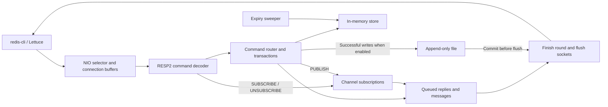

# MiniRedis

A Java 21 Redis-compatible server for learning RESP2, nonblocking I/O and persistence. It supports strings, counters, lists, hashes, key expiry, transactions and channel Pub/Sub.

## Run

Open the project in IntelliJ and run `com.example.miniredis.Main` with program arguments `6380 none` for an in-memory instance. Or compile with Maven and run:

```powershell
mvn compile
java -cp target/classes com.example.miniredis.Main 6380 none
redis-cli -p 6380 PING
```

Use `6380 appendonly.aof always 0` to enable AOF persistence with group fsync and disable automatic rewrite.

## Compatibility checks

- **Day 12:** 14 Lettuce checks passed over RESP2, including lists, hashes, MULTI/EXEC and channel Pub/Sub. Start MiniRedis on port 6380, then run `LettuceCompatibilityCheck.main()` from `src/test/java` in IntelliJ.
- **Day 13:** The Spring Boot CRUD API used MiniRedis for rate limiting. With a test limit of five, the API returned HTTP 429. MiniRedis held the matching counter at 7 with 38 seconds remaining.

The server uses a Java NIO selector, an expiry index and background sweeper, and an append-only log. In always mode, a round of commands shares a commit before replies are sent. Pub/Sub messages are transient. The tested compatibility scope is RESP2 and UTF-8 text. The Day 13 check covered the rate limiter.

## Architecture



See [benchmark instructions and measured results](BENCHMARKS.md).
